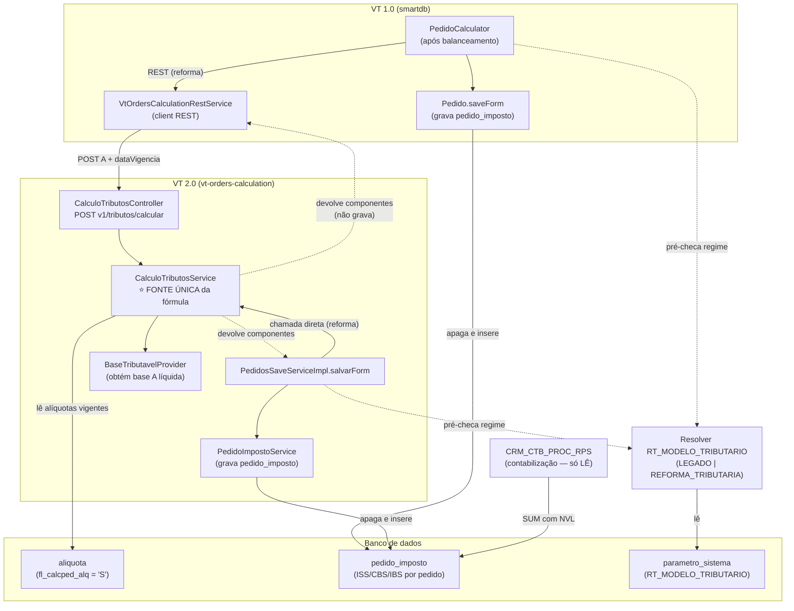
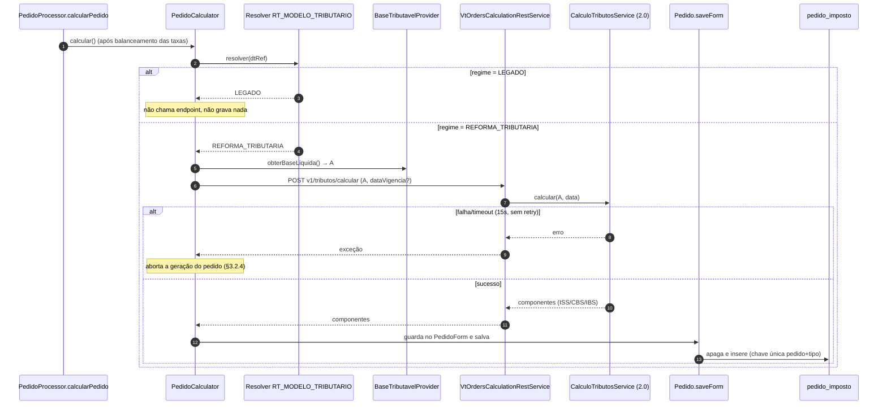
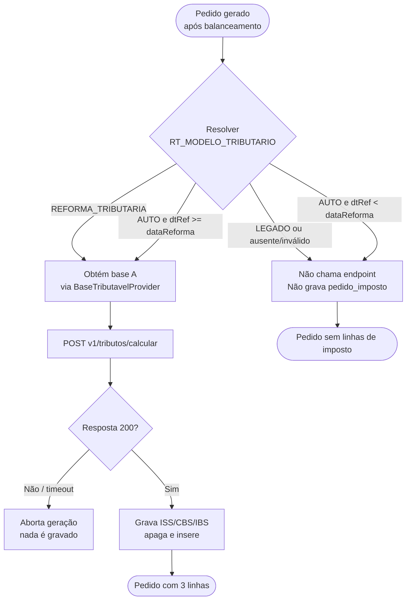
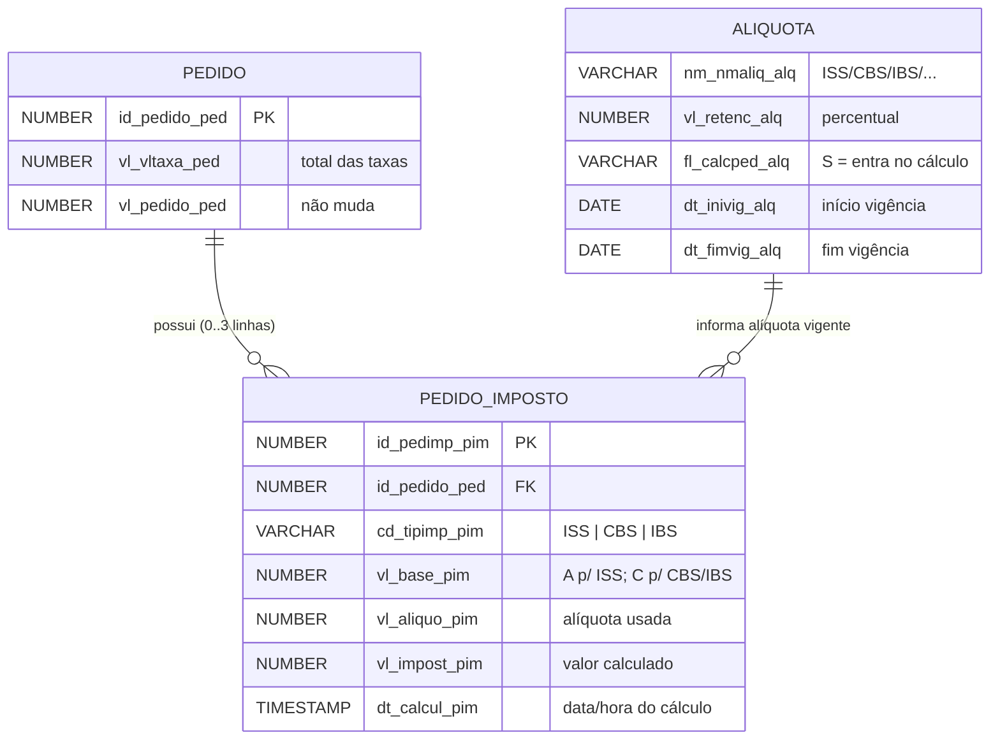

# Refinamento Técnico — US 1747321: Cálculo de CBS/IBS no Pedido (Caminho A — total das taxas, "por fora")

> **O que é:** calcular ISS, base, CBS e IBS na **geração do pedido** e **gravar** cada etapa em uma tabela nova
> (`pedido_imposto`). O valor **não** é somado ao pedido/título/boleto/nota — o imposto fica embutido no preço (a
> cargo de Preços — §2.2). A contabilização passa a **ler** esses valores.
>
> **Pré-requisito:** o parâmetro de regime `RT_MODELO_TRIBUTARIO` e seu resolver
> ([Refinamento do `RT_MODELO_TRIBUTARIO`](https://dev.azure.com/alelo/ValeTransporte-2.0/_wiki/wikis/ValeTransporte-2.0.wiki/72603/Refinamento-T%C3%A9cnico-%E2%80%94-Constru%C3%A7%C3%A3o-do-Par%C3%A2metro-RT_MODELO_TRIBUTARIO)).
>
> ⚠️ **Impacto confirmado — Preços vai embutir CBS/IBS na tarifa (bloqueia o cálculo):** a base `A` precisa ser o
> valor **líquido**, mas `vl_vltaxa_ped` passará a conter o imposto. O VT terá de **receber o líquido de Preços**
> (novo local/formato) ou **extraí-lo** antes de calcular. Falta Preços definir **como, em que formato e quando** —
> ver §2.2. Sem isso, as tasks de cálculo (T3a/T4) não podem começar e há risco para o go-live de 01/01/2027.

---

## 1. Banco de dados

### 1.1. Tabela nova `pedido_imposto`

Uma linha por componente (ISS, CBS, IBS), 2 casas decimais, amarrada ao pedido. Um imposto novo entra como nova
linha, sem novo DDL.

| Coluna          | Tipo           | Nulo | Descrição                                                                   |
| --------------- | -------------- | ---- | --------------------------------------------------------------------------- |
| `ID_PEDIMP_PIM` | `NUMBER(10)`   | Não  | PK (sequence própria)                                                       |
| `ID_PEDIDO_PED` | `NUMBER(10)`   | Não  | FK do pedido                                                                |
| `CD_TIPIMP_PIM` | `VARCHAR2(10)` | Não  | Componente: `ISS`, `CBS` ou `IBS`                                           |
| `VL_BASE_PIM`   | `NUMBER(15,2)` | Não  | Base de incidência (`A` para ISS; `C` para CBS/IBS)                         |
| `VL_ALIQUO_PIM` | `NUMBER(9,2)`  | Não  | Alíquota usada no cálculo                                                   |
| `VL_IMPOST_PIM` | `NUMBER(15,2)` | Não  | Valor calculado                                                             |
| `DT_CALCUL_PIM` | `TIMESTAMP`    | Não  | Data e hora do cálculo (resolve a vigência pela data; carimbo de auditoria) |

- **Chave única `(ID_PEDIDO_PED, CD_TIPIMP_PIM)`** + gravação **"apaga e insere" por pedido** (a Recarga Certa
  recalcula o pedido já gravado — §3.3).
- **Sem coluna de regime:** em `LEGADO` nada é gravado, então toda linha é sempre reforma; a existência da linha já
  significa isso.
- `TIMESTAMP` (e não só data) porque a Recarga Certa regrava as linhas no retorno do parceiro — o horário distingue
  a gravação da geração da do recálculo.

#### 1.1.1. Exemplo

Pedido 120345, `vl_vltaxa_ped` = R$ 100,00; ISS 2%, CBS 8,90%, IBS 0,10%:

```
A = 100,00  →  ISS = 2,00  →  C = 98,00  →  CBS = 8,72  →  IBS = 0,10
```

| `CD_TIPIMP_PIM` | `VL_BASE_PIM` | `VL_ALIQUO_PIM` | `VL_IMPOST_PIM` |
| --------------- | ------------- | --------------- | --------------- |
| `ISS`           | 100.00        | 2.00            | 2.00            |
| `CBS`           | 98.00         | 8.90            | 8.72            |
| `IBS`           | 98.00         | 0.10            | 0.10            |

```sql
INSERT INTO pedido_imposto (id_pedimp_pim, id_pedido_ped, cd_tipimp_pim, vl_base_pim, vl_aliquo_pim,
                            vl_impost_pim, dt_calcul_pim)
VALUES (sq_pedido_imposto.NEXTVAL, 120345, 'ISS', 100.00, 2.00, 2.00, SYSTIMESTAMP);
-- idem para 'CBS' (98.00, 8.90, 8.72) e 'IBS' (98.00, 0.10, 0.10)
```

`vl_pedido_ped`, título, boleto e nota continuam R$ 100,00 — `pedido_imposto` **não** é somado a nada.

### 1.2. Alteração da `aliquota` — flag `fl_calcped_alq`

A `aliquota` ganha um flag que diz **quais impostos entram no cálculo do pedido** (as colunas de vigência
`dt_inivig_alq`/`dt_fimvig_alq` são do doc `05` — combinar o `ALTER` com aquela US).

```sql
ALTER TABLE aliquota ADD (
  fl_calcped_alq VARCHAR2(1) DEFAULT 'N'   -- 'S' = calculado na geração do pedido; 'N' = não
);

UPDATE aliquota SET fl_calcped_alq = 'S' WHERE UPPER(TRIM(nm_nmaliq_alq)) IN ('ISS', 'CBS', 'IBS');
COMMIT;
```

Só ISS, CBS e IBS ficam `'S'`; os demais (PIS, COFINS, ICMS, legados) ficam no default `'N'`.

- **A regra de base fica no serviço (§3.2.2), não na tabela:** ISS é deduzido, os demais incidem sobre `C = A − ISS`.
  Um imposto novo sobre `C` entra só com cadastro na `aliquota`, sem mexer no código.
- **Herança do flag na nova vigência (task T1d):** ao criar vigência nova de um imposto, a linha deve herdar o
  `fl_calcped_alq` da anterior, senão nasce `N` e o imposto sai do cálculo na virada.
- Percentuais (ISS 2%, CBS 8,9%, IBS 0,1%) são **referência**; os valores reais vêm da `aliquota` por vigência.

---

## 2. Regra de cálculo

**Entrada `A` = tarifa líquida.** Hoje isso é `pedido.vl_vltaxa_ped` direto (o mesmo valor que a nota usa como
`vl_totenc_nfs`), então a base de IBS/CBS fica igual à base dos tributos de hoje. **Atenção:** com a mudança de
Preços (embutir CBS/IBS na tarifa), `A` deixa de ser `vl_vltaxa_ped` direto e passa a ser o líquido obtido conforme
a §2.2 — a fórmula abaixo não muda, só a origem de `A`.

```
A   = base líquida (via BaseTributavelProvider — §2.3; hoje = pedido.vl_vltaxa_ped)
ISS = round(A × %ISS, 2)
C   = A − ISS                 (base de IBS e CBS)
CBS = round(C × %CBS, 2)
IBS = round(C × %IBS, 2)
```

O cálculo **não** soma nada a `vl_pedido_ped`/taxa/título/boleto/nota.

### 2.1. Arredondamento

- **Por componente:** cada imposto é arredondado e gravado **independentemente**, com **2 casas**. Não há soma de
  IBS + CBS (nem total consolidado) em nenhum ponto — cada tributo segue sozinho para `pedido_imposto` e para o
  lançamento contábil.
- **Modo:** `HALF_UP` (meio para cima), padrão do `BigDecimalUtil` do `vt-orders-calculation`
  (`roundToCurrency`/`calculatePercentageAndRound`). Usar o mesmo nos dois mundos para garantir paridade 1.0 × 2.0.
- **Escala intermediária:** dividir a alíquota por 100 com escala maior (o util usa 10 casas) **antes** de
  arredondar o valor do imposto para 2 casas. Só o valor final de cada componente tem 2 casas.

### 2.2. Base `A` — Preços vai embutir CBS/IBS na tarifa (⚠️ impacto confirmado)

Hoje a tarifa cadastrada (`vl_vltaxa_ped`) é o **preço líquido** (sem IBS/CBS), e o VT calcula o imposto sobre ela e
grava para a contabilidade — é a premissa da fórmula do §2.

**Confirmado (Preços):** a área de Preços **vai passar a embutir CBS e IBS na tarifa**. A partir daí, `vl_vltaxa_ped`
deixa de ser líquido e passa a conter o imposto — então **o VT não pode mais calcular direto sobre essa tarifa**
(incidiria imposto sobre imposto, inflando o valor contábil: ~R$ 1,23 a maior por R$ 100 de tarifa.

**Consequência:** o VT precisa obter o **valor líquido** para usar como base `A`. Ou Preços envia o líquido em um
**novo local/formato**, ou o VT faz a **extração reversa** a partir das alíquotas vigentes. Isso **altera a entrada
do cálculo** descrita no §2 e na §3.

> ⚠️ **Em aberto com Preços (bloqueia o cálculo — T3a/T4):**
>
> - **Como** o líquido chega ao VT: Preços envia o líquido num novo campo/local, ou o VT deriva por cálculo reverso?
> - **Formato:** valor **único** (líquido total) ou **por componente** (quanto é CBS, quanto é IBS)?
> - **Onde** o VT lê a tarifa muda de lugar?
> - **Quando:** data de envio — **antes** do início do desenvolvimento do cálculo.
>
> **Impacto se não for definido a tempo:**
>
> - O desenvolvimento de cálculo/gravação de IBS/CBS (T3a/T3b/T4) teria de ser **refeito** sobre a nova entrada.
> - Muda **o ponto de onde o VT lê a tarifa** e a **origem dos valores** enviados às contas contábeis.
> - Sem formato e data definidos, **não dá para planejar a solução** e o esforço fica **imprevisível**.
> - **Risco de atraso na entrega de 01/01/2027.**
>
> **O restante do refinamento não muda:** persistência (`pedido_imposto`), fonte única no endpoint, arredondamento
> por componente, pré-checagem de regime e contabilização continuam válidos. O que muda é **qual valor entra como
> base `A`** — hoje `vl_vltaxa_ped` direto; depois, o líquido obtido conforme a definição de Preços.

### 2.3. Como se adiantar à definição de Preços (sem esperar o formato)

A indefinição de Preços afeta **só a origem da base `A`**, não o resto do cálculo. Dá para blindar o
desenvolvimento com duas medidas, de modo que a virada vire **troca de uma peça**, não retrabalho:

**(a) Isolar a obtenção de `A` atrás de uma interface.** Nenhum ponto passa `vl_vltaxa_ped` direto ao cálculo;
todos chamam um provedor, ex.:

```java
public interface BaseTributavelProvider {
    BigDecimal obterBaseLiquida(/* pedido / taxas / dataVigencia */);
}
```

- **Implementação de hoje (`BaseLiquidaDiretaProvider`):** devolve `vl_vltaxa_ped` como está (tarifa ainda líquida).
  É o comportamento atual e serve para desenvolver e testar tudo agora.
- **Quando Preços definir:** troca-se **só a implementação** (ler o novo campo, ou usar a extração reversa de (b)).
  `PedidoCalculator`, endpoint, gravação e contabilização **não mudam**.

**(b) Já implementar a extração reversa como uma das implementações.** Para o cenário "Preços embute o imposto na
tarifa e **não** envia o líquido separado", o líquido é derivado do bruto com as alíquotas vigentes (que o serviço
já lê da `aliquota`):

```
líquido (C) = bruto / (1 + %CBS + %IBS)      // extrai IBS/CBS embutidos
A          = líquido + ISS                    // repõe o ISS para chegar à base A (ISS incide sobre A)
```

> A fórmula exata do reverso (como o ISS entra) depende de como Preços embute os tributos — fechar junto da
> definição. O importante: a **lógica reversa fica dentro do provedor (b)**, atrás da mesma interface de (a), então
> entra sem tocar no resto. Testar com o caso fechado: bruto 111,07 + alíquotas vigentes → líquido/`A` → ISS/CBS/IBS.

> **Resultado:** com (a) e (b) prontos, o único trabalho que resta quando Preços definir é **escolher/implementar a
> implementação certa do provedor** (campo novo vs. reverso). Todo o fluxo de cálculo, gravação e contabilização
> pode ser desenvolvido e testado **antes** dessa definição, reduzindo o risco para o go-live (§2.2).

---

## 3. Onde e quando calcular (código)

### 3.0. Diagramas técnicos

Os diagramas abaixo resumem os fluxos e integrações descritos nas seções 2, 3 e 4. São uma visão de apoio — a regra
detalhada está no texto de cada seção.

#### 3.0.1. Visão geral — arquitetura e integrações

Fonte única da fórmula no `vt-orders-calculation`: o 1.0 chama por REST; o 2.0 chama o serviço direto. A gravação
em `pedido_imposto` fica com quem tem o pedido. A contabilização apenas lê.



#### 3.0.2. Sequência — geração do pedido no 1.0 (regime Reforma)



#### 3.0.3. Fluxo de decisão — pré-checagem do regime



#### 3.0.4. Entidade `pedido_imposto`



### 3.1. Posição no fluxo

Último passo, **depois do balanceamento das taxas**. Só roda em `REFORMA_TRIBUTARIA` (pré-checagem em §3.1.1).

| Ambiente                 | Artefato                                                                                                                                                                                      | Ação                                                                                                                                 |
| ------------------------ | --------------------------------------------------------------------------------------------------------------------------------------------------------------------------------------------- | ------------------------------------------------------------------------------------------------------------------------------------ |
| 1.0 (cálculo)            | `smartdb/.../pedido/PedidoCalculator.java` (após o total das taxas, ~l.1040)                                                                                                                  | obter `A` pelo `BaseTributavelProvider` (§2.3), **calcular** e guardar o resultado no `PedidoForm`. Não altera `vl_pedido_ped`       |
| 1.0 (gravação)           | `Pedido.saveForm` (`smart/database/historico/Pedido.java`)                                                                                                                                    | **gravar** `pedido_imposto` depois do ID (`sq_pedido`, ~l.416), junto com o insert das taxas (~l.806–816), na mesma transação (§3.3) |
| 2.0 (cálculo + gravação) | `vt-orders-calculation`: `ProcessadorPedidoComponent.processaPedido` → `PedidosSaveServiceImpl.salvarForm` (`criarSalvarPedido` dá o ID; `pedidoTaxasService.salvaListaTaxas` grava as taxas) | chamar o `CalculoTributosService` e gravar `pedido_imposto` com um `PedidoImpostoService` novo **logo após `salvaListaTaxas`**       |
| Serviço de cálculo       | `vt-orders-calculation` — `CalculoTributosController`/`CalculoTributosService` novos (§3.2)                                                                                                   | **fonte única**; o 1.0 chama por REST, o 2.0 chama o serviço direto                                                                  |
| Regime                   | resolver Java do `RT_MODELO_TRIBUTARIO`                                                                                                                                                       | decide se o cálculo roda (§3.1.1); não é PL/SQL                                                                                      |

> No 2.0 é preciso criar `AliquotaEntity`+`AliquotaRepository` (não existem hoje). Peças reaproveitáveis (JPA,
> `BigDecimalUtil`, padrão de contabilidade) em `09A` §8. O endpoint antigo do balanceador
> (`processarPedidoUsuarioBalanceado`) **continua em uso — não desativar**.

### 3.1.1. Verificação do regime ANTES de calcular (pré-checagem) ⭐

O regime vem do resolver do `RT_MODELO_TRIBUTARIO` (refinamento próprio, já compartilhado): lê o parâmetro em
`parametro_sistema` (JSON), só em Java, com cache de TTL curto. Contrato: `RegimeTributario resolver(LocalDate dtRef)`
— nunca lança; em erro/ausência devolve `LEGADO`. **Saída sempre `LEGADO` ou `REFORMA_TRIBUTARIA`.** O `dtRef` é a
data de referência do pedido (na geração, "hoje").

| `regime` no JSON       | Resolve para                                                   | Observação                               |
| ---------------------- | -------------------------------------------------------------- | ---------------------------------------- |
| `LEGADO`               | `LEGADO`                                                       | Valor de produção em todo 2026; rollback |
| `REFORMA_TRIBUTARIA`   | `REFORMA_TRIBUTARIA`                                           | Força a reforma (HML/teste)              |
| `AUTO` + `dataReforma` | `REFORMA_TRIBUTARIA` se `dtRef >= dataReforma`, senão `LEGADO` | Virada automática                        |
| ausente/inválido       | `LEGADO`                                                       | Default seguro                           |

**Onde pré-checar:**

- **1.0:** no próprio `PedidoCalculator` (ponto central, não nos 6 chamadores), via `RegimeTributarioDAO` com cache.
- **2.0:** no fluxo de save, antes de persistir, via `RegimeTributarioService`.

```java
// 1.0 — no PedidoCalculator, após fechar o total das taxas e ANTES de chamar o endpoint
RegimeTributario regime = regimeTributarioResolver.resolver(dtRef);
if (regime != RegimeTributario.REFORMA_TRIBUTARIA) {
    return;   // LEGADO: não chama o endpoint, não grava nada
}
// REFORMA_TRIBUTARIA → A = baseTributavelProvider.obterBaseLiquida(...) (§2.3); chama POST v1/tributos/calcular (dataVigencia opcional; default = hoje)
```

Em `LEGADO` (todo 2026) nem se faz a chamada REST.

### 3.2. Fonte única do algoritmo — endpoint no `vt-orders-calculation` ⭐

A fórmula **não pode existir em dois lugares** (Java e PL/SQL): divergiria e o contábil passaria a diferir do fiscal.
O cálculo fica em **um endpoint novo** no `vt-orders-calculation`, que o 1.0 já consome por REST. Os dois mundos
chamam o mesmo endpoint, logo após o balanceamento.

> **O endpoint só CALCULA e DEVOLVE; não grava.** Recebe `A` e a data, devolve os componentes. A gravação de
> `pedido_imposto` fica com quem tem o pedido (no 1.0 o ID só existe no `saveForm`):
>
> - **1.0:** `PedidoCalculator` chama, recebe o resultado e grava no `saveForm` (§3.3).
> - **2.0:** chama o `CalculoTributosService` direto e grava junto da `salvaListaTaxas` (§3.1).

### 3.2.1. Contrato (genérico por imposto)

**`POST v1/tributos/calcular`** — lê da `aliquota` as linhas com `fl_calcped_alq = 'S'` e devolve um componente
para cada (sem lista fixa de impostos).

**Request:**

```java
public record CalculoTributosRequest(
    BigDecimal baseTaxas,   // A = vl_vltaxa_ped. Obrigatório, >= 0
    LocalDate dataVigencia  // dtRef: resolve regime e alíquotas vigentes. OPCIONAL — se null, o serviço usa a data atual
) {}
```

> **`dataVigencia` é opcional.** Na geração do pedido a referência é "hoje", então o caso comum **não precisa
> enviá-la** — o serviço assume a data atual. Enviar explicitamente serve para (a) **testar a virada** 31/12 → 01/01
> sem mexer no relógio e (b) **congelar a vigência** quando o chamador quiser (ex.: recálculo da Recarga Certa que
> queira manter a data da geração). O endpoint continua sem estado — não busca a data em lugar nenhum além do request.

**Response:**

```json
{
  "status": "OK",
  "mensagem": null,
  "response": {
    "dataCalculo": "2027-01-15",
    "componentes": [
      { "tipo": "ISS", "base": 100.0, "aliquota": 2.0, "valor": 2.0 },
      { "tipo": "CBS", "base": 98.0, "aliquota": 8.9, "valor": 8.72 },
      { "tipo": "IBS", "base": 98.0, "aliquota": 0.1, "valor": 0.1 }
    ]
  }
}
```

- Os `componentes` espelham o `pedido_imposto`: `tipo`→`CD_TIPIMP_PIM`, `base`→`VL_BASE_PIM`,
  `aliquota`→`VL_ALIQUO_PIM`, `valor`→`VL_IMPOST_PIM`; `dataCalculo`→`DT_CALCUL_PIM`.
- **`LEGADO`:** `componentes` vazio. Erro de parâmetro/alíquota: `status = "NOK"` e o chamador não grava.
- Sem efeito colateral: não lê nem grava pedido.

### 3.2.2. Como o serviço lê os impostos da `aliquota`

```sql
SELECT nm_nmaliq_alq, vl_retenc_alq
  FROM aliquota
 WHERE fl_calcped_alq = 'S'
   AND :dataVigencia BETWEEN dt_inivig_alq AND NVL(dt_fimvig_alq, DATE '9999-12-31');
```

Regra de base no serviço: calcula o **ISS sobre `A`**, deriva `C = A − ISS` e aplica **os demais sobre `C`** (o
serviço só precisa saber qual linha é o ISS, pelo nome). Ver a variante com `EXISTS` (herança do flag) em `09A` §10.

### 3.2.3. Esqueleto (ponto de partida)

Padrão do `vt-orders-calculation`: `record` de request/response, controller com Swagger, `HttpGenericResponse`.

```java
// controllers/request/CalculoTributosRequest.java
public record CalculoTributosRequest(BigDecimal baseTaxas, LocalDate dataVigencia) {}

// controllers/response/CalculoTributosResponse.java
public record CalculoTributosResponse(
    LocalDate dataCalculo,
    List<ComponenteTributoResponse> componentes
) {}
public record ComponenteTributoResponse(
    String tipo, BigDecimal base, BigDecimal aliquota, BigDecimal valor
) {}
```

```java
// controllers/CalculoTributosController.java
@PostMapping(path = "v1/tributos/calcular", produces = "application/json")
public HttpGenericResponse calcular(@RequestBody CalculoTributosRequest request) {
    var resultado = calculoTributosService.calcular(request.baseTaxas(), request.dataVigencia());
    return HttpGenericResponse.builder().status("OK").response(resultado).build();
}
```

```java
// service/CalculoTributosService.java — núcleo da fonte única
public CalculoTributosResponse calcular(BigDecimal baseTaxas, LocalDate dataVigencia) {
    LocalDate data = (dataVigencia != null) ? dataVigencia : LocalDate.now();   // opcional: default = hoje
    if (!regimeCalcula(regimeVigente(data))) {                     // LEGADO => vazio
        return new CalculoTributosResponse(data, List.of());
    }
    List<ImpostoVigente> impostos = montarImpostosVigentes(data);  // aliquota, fl_calcped_alq='S' (§3.2.2)

    BigDecimal iss   = valorDoImposto(impostos, "ISS", baseTaxas);  // ISS sobre A
    BigDecimal baseC = baseTaxas.subtract(iss);                     // C = A − ISS

    List<ComponenteTributoResponse> componentes = new ArrayList<>();
    componentes.add(new ComponenteTributoResponse("ISS", baseTaxas, aliqIss, iss));
    for (ImpostoVigente imp : impostos) {
        if (imp.ehIss()) continue;
        BigDecimal valor = baseC.multiply(imp.aliquota()).divide(CEM, 2, RoundingMode.HALF_UP);  // demais sobre C
        componentes.add(new ComponenteTributoResponse(imp.nome(), baseC, imp.aliquota(), valor));
    }
    return new CalculoTributosResponse(data, componentes);
}
```

> Esqueleto para orientar; nomes finais, `@Valid` e tratamento de erro no `CustomRestExceptionHandler` ficam com o dev.

### 3.2.4. Resiliência da chamada (decidido: falha aborta o pedido)

O 1.0 chama o endpoint pelo mesmo `ApiClient`/padrão REST que já usa no balanceamento (`v1/balance/generic`). O
comportamento adotado é o **mesmo do balanceador de hoje**:

- **Timeout:** `CONNECT_TIMEOUT_MS` e `RESPONSE_TIMEOUT_MS` = **15s** (padrão do `ApiClient`).
- **Sem retry:** uma única chamada por cálculo (como o `performGenericBalancing`). Não há reprocessamento automático.
- **Falha = aborta o pedido (DECIDIDO).** Se o endpoint responder diferente de 200, der timeout ou erro de rede, o
  1.0 **lança exceção e interrompe a geração do pedido** (mesmo padrão do `BalanceamentoException`). **Não** se grava
  o pedido sem o imposto nem se segue com valor parcial: em `REFORMA_TRIBUTARIA` o imposto é obrigatório, então um
  pedido que não conseguiu calcular **não é gravado** e o erro sobe para o fluxo tratar/reprocessar.
- **`LEGADO` não é afetado:** nesse regime o endpoint nem é chamado (§3.1.1), então indisponibilidade do 2.0 não
  impacta a geração de pedidos em 2026.
- **No 2.0** (chamada direta ao `CalculoTributosService`, sem REST): a falha do cálculo também **propaga** e aborta
  o `salvarForm` na mesma transação — não gravar as taxas sem o `pedido_imposto` correspondente.

> Motivo: o imposto vai para a contabilidade; gravar um pedido "pela metade" (taxas sim, imposto não) criaria
> divergência fiscal silenciosa. Em `REFORMA_TRIBUTARIA` é preferível falhar a geração e reprocessar.

### 3.3. Por que calcular e gravar são passos separados (1.0) ⭐

No 1.0 o `calcular()` roda **antes** de o pedido ter ID (`calcularPedido` → ... → `Pedido.saveForm`, que gera o
`id_pedido_ped`). Como `pedido_imposto` tem FK do pedido, **calcula-se no `PedidoCalculator` e grava-se no `saveForm`**
(daí as tasks T3 e T3b). A gravação é **"apaga e insere"** por pedido (chave única `(pedido, tipo)`), senão o
recálculo da Recarga Certa duplicaria as linhas — "pedido não é editável" vale para o usuário, não para o sistema.

**Quem chama `calcular()` no 1.0 e se grava:**

| Chamador                                                   | O que é                    | Grava?                               |
| ---------------------------------------------------------- | -------------------------- | ------------------------------------ |
| `PedidoProcessor.calcularPedido`                           | geração do pedido          | **Sim** (INSERT)                     |
| `PedidoValidator` (~l.899)                                 | previsão (`vl_prvpag_ped`) | **Não** (só calcula)                 |
| `CobrancaRcServiceImpl.cobrancaPedidoComDesconto` (~l.193) | recálculo da Recarga Certa | **Sim**, regravando (apaga e insere) |

> **Fora do escopo:** compra/pai-filho (`PedidoCompraDAO`), SPTrans (`SPTransDAO`) e título manual
> (`AJAXTituloAction`) **não** passam pelo `PedidoCalculator`, então não calculam. Título e boleto **não mudam**.
> Ciclo da Recarga Certa, fluxos fora do calculator e onde o balanceamento roda no 2.0: `09A` §3, §6 e §8.

---

## 4. Contabilização lê do que foi gravado

O gatilho não muda: continua na emissão da nota, dentro da `CRM_NFISCALPED`, que chama `crm_ctb_proc_rps` por nota.
O que muda é a origem: em vez de recalcular, **lê** `pedido_imposto`. A nota **não** soma o imposto a `vl_totnot_nfs`.
A contabilização é detalhada no **[Refinamento Técnico — Contabilização de CBS/IBS na `CRM_CTB_PROC_RPS`](https://dev.azure.com/alelo/ValeTransporte-2.0/_wiki/wikis/ValeTransporte-2.0.wiki/72219/Refinamento-T%C3%A9cnico-Contabiliza%C3%A7%C3%A3o-de-CBS_IBS-na-CRM_CTB_PROC_RPS)**;
achados de código que embasam este ponto em `09A` §5.

```plsql
-- lê o que o pedido gravou (não consulta regime)
SELECT SUM(CASE WHEN cd_tipimp_pim = 'CBS' THEN vl_impost_pim END),
       SUM(CASE WHEN cd_tipimp_pim = 'IBS' THEN vl_impost_pim END)
  INTO v_vl_cbs, v_vl_ibs
  FROM pedido_imposto
 WHERE id_pedido_ped = P_id_pedido_ped;
-- gera os lançamentos; NÃO somar ao vl_totnot_nfs / vl_tottit_tit
```

- **Leitura à prova de falha:** `SUM` com `NVL`, sem linhas = 0 (um erro aqui abortaria a emissão da nota).
- Contas, eventos e idempotência do lançamento ficam no refinamento da Contabilização (link acima).

---

## 5. Tasks e sequenciamento

### T1 — DDL da tabela `pedido_imposto` (§1.1)

Criar a tabela `pedido_imposto` (colunas da §1.1), a sequence `sq_pedido_imposto` e um índice por `ID_PEDIDO_PED`,
com a chave única `(ID_PEDIDO_PED, CD_TIPIMP_PIM)`.
**Resultado:** tabela pronta para receber uma linha por componente (ISS/CBS/IBS) por pedido.
**Depende de:** — · **Paraleliza com:** T1b, T2

### T1b — DDL do flag na `aliquota` (§1.2)

`ALTER TABLE aliquota ADD (fl_calcped_alq VARCHAR2(1) DEFAULT 'N')` e rodar o `UPDATE` que marca ISS/CBS/IBS com
`'S'`. Combinar com o doc `05` quem roda o `ALTER` (as colunas de vigência são daquela US).
**Resultado:** a `aliquota` passa a indicar quais impostos entram no cálculo do pedido.
**Depende de:** — · **Paraleliza com:** T1

### T1c — Acesso à `aliquota` e ao regime no 2.0 (§3.1.1, §3.2.2)

No `vt-orders-calculation`, criar `AliquotaEntity` + `AliquotaRepository` (não existem hoje) para a consulta da
§3.2.2, e integrar o resolver do `RT_MODELO_TRIBUTARIO` (do refinamento próprio) para a pré-checagem do regime.
**Resultado:** o 2.0 consegue ler as alíquotas vigentes e resolver o regime.
**Depende de:** T1b · **Paraleliza com:** —

### T1d — Herança do `fl_calcped_alq` na nova vigência

O flag nasce `DEFAULT 'N'` e cada mudança de alíquota cria uma **linha nova** por vigência; se a linha nova nascer
`N`, o imposto some do cálculo na virada (ex.: CBS 0,9% → 8,9% em 01/01/2027), sem erro. Implementar:

- **(a) Escrita (cadastro, doc `05`):** ao criar vigência nova de um imposto, **copiar** o `fl_calcped_alq` da
  vigência anterior do mesmo imposto, em vez do default. Alinhar com o time do doc `05` quem implementa.
- **(b) Leitura (serviço, §3.2.2):** resolver "quais impostos calcular" **por nome do imposto** (entra se alguma
  vigência estiver `'S'`), como defesa extra.

SQL das duas abordagens em `09A` §10.
**Resultado:** na virada de vigência, nenhum imposto marcado sai do cálculo silenciosamente.
**Depende de:** T1b · **Paraleliza com:** T2

### T2 — Endpoint de cálculo no `vt-orders-calculation` (§3.2)

Criar `CalculoTributosController` + `CalculoTributosService` + records de request/response (§3.2.1, §3.2.3). O
serviço lê da `aliquota` as linhas com `fl_calcped_alq = 'S'` vigentes na data (§3.2.2), aplica a regra de base (ISS
sobre `A`; demais sobre `C = A − ISS`) e devolve os componentes. **Só calcula e devolve — não grava.** É a **fonte
única** da fórmula, chamada pelo 1.0 (REST) e pelo 2.0 (direto).
**Resultado:** `POST v1/tributos/calcular` devolvendo ISS/CBS/IBS para uma base `A` e uma data.
**Depende de:** T1b, T1c · **Paraleliza com:** T1

### T2b — Provedor da base `A` (blindagem contra a definição de Preços) (§2.3)

Criar a interface `BaseTributavelProvider` e duas implementações: **`BaseLiquidaDiretaProvider`** (devolve
`vl_vltaxa_ped`, comportamento de hoje) e **`BaseLiquidaReversaProvider`** (extrai o líquido do bruto pelas
alíquotas vigentes — §2.3b). Todos os chamadores do cálculo usam a interface, **nunca** `vl_vltaxa_ped` direto.
A escolha da implementação fica parametrizável. **Independe de Preços** — permite desenvolver/testar T3a/T4 já.
**Resultado:** a origem da base `A` isolada; a virada de Preços vira troca de implementação, não retrabalho.
**Depende de:** T1b (alíquotas) · **Paraleliza com:** T2

### T3 — 1.0: client REST para consumir o endpoint (§3.2)

No `smartdb`, adicionar em `VtOrdersCalculationRestService` (ou equivalente que já faz `httpPost` para
`v1/balance/generic`) o método que chama **`POST v1/tributos/calcular`**: monta o request (`baseTaxas = A`,
`dataVigencia` opcional), faz o `httpPost` e desserializa o response em um DTO com a lista de componentes.
**Resultado:** o 1.0 tem um client pronto para obter ISS/CBS/IBS a partir de `A`.
**Depende de:** T2 · **Paraleliza com:** T4

### T3a — 1.0: pré-checar o regime e chamar o client no `PedidoCalculator` (§3.1.1, §3.3)

No `PedidoCalculator` (`smartdb/.../pedido/PedidoCalculator.java`, após fechar o total das taxas, ~l.1040): chamar o
resolver do regime (via `RegimeTributarioDAO` com cache) e, **só em `REFORMA_TRIBUTARIA`**, chamar o client da T3 com
`A` obtido do `BaseTributavelProvider` (T2b — **não** passar `vl_vltaxa_ped` direto) e guardar o resultado no
`PedidoForm`. **Não** alterar `vl_pedido_ped`/taxa/título/boleto. Em `LEGADO`, não chama e não guarda nada. **Falha
do endpoint aborta a geração do pedido** (§3.2.4).
**Resultado:** o `PedidoForm` carrega os componentes calculados (quando reforma), sem mudar o valor cobrado.
**Depende de:** T3 · **Paraleliza com:** T4

### T3b — 1.0: gravar `pedido_imposto` no `saveForm` (§3.3)

No `Pedido.saveForm` (`smart/database/historico/Pedido.java`), depois de gerar o ID (`sq_pedido`, ~l.416) e junto do
insert das taxas (~l.806–816, mesma transação): inserir as linhas de `pedido_imposto` que vieram no `PedidoForm`, em
modo **"apaga e insere"** (apaga as linhas do pedido e reinsere) para o recálculo da Recarga Certa não duplicar.
**Resultado:** o pedido gravado tem as 3 linhas (ISS/CBS/IBS); recálculo da RC regrava sem duplicar.
**Depende de:** T1, T3a · **Paraleliza com:** T4

### T4 — 2.0: pré-checar o regime, calcular e gravar (§3.1, §3.1.1)

No `vt-orders-calculation`, dentro de `PedidosSaveServiceImpl.salvarForm` — **logo após `pedidoTaxasService.salvaListaTaxas`**
(pedido já com ID e taxas já balanceadas): pré-checar o regime (`RegimeTributarioService`) e, em
`REFORMA_TRIBUTARIA`, obter o `A` via `BaseTributavelProvider` (T2b), chamar o `CalculoTributosService` e persistir
`pedido_imposto` com um `PedidoImpostoService`
novo (no padrão JPA do `PedidoTaxasServiceImpl`), também em "apaga e insere". Falha do cálculo **propaga** e aborta
o `salvarForm` na mesma transação (§3.2.4).
**Resultado:** pedido salvo pelo 2.0 grava `pedido_imposto` igual ao 1.0.
**Depende de:** T1, T2 · **Paraleliza com:** T3

### T5 — Contabilização lê `pedido_imposto` (§4)

Ajustar a `CRM_CTB_PROC_RPS` para **ler** CBS/IBS de `pedido_imposto` (`SUM` com `NVL`, sem linhas = 0) em vez de
recalcular, gerar os lançamentos e **não** somar ao `vl_totnot_nfs`/`vl_tottit_tit` (§4; refinamento da Contabilização).
**Resultado:** contabilização reflete o que o pedido gravou.
**Depende de:** T1, T3b · **Paraleliza com:** —

### T6 — Testes QA

Cobrir, no mínimo:

- **Regressão:** `vl_pedido_ped`, título, boleto e nota **idênticos ao atual** em `LEGADO` e em reforma; retenção da
  economia mista (`vl_retimp_ped`) inalterada.
- **Cálculo:** exemplo da §1.1.1 (A 100 → ISS 2 / C 98 / CBS 8,72 / IBS 0,10), cada linha com sua base.
- **Pré-checagem:** `LEGADO` não chama o endpoint nem grava; `REFORMA_TRIBUTARIA` chama e grava; parâmetro ausente
  ⇒ `LEGADO`; modo `AUTO` na virada 31/12/2026 → 01/01/2027.
- **Endpoint:** chamada **sem** `dataVigencia` usa a data atual; chamada **com** `dataVigencia` resolve a vigência/regime
  por essa data (testar a virada passando a data explícita).
- **Falha do endpoint (§3.2.4):** em `REFORMA_TRIBUTARIA`, endpoint indisponível/timeout/erro → a geração do pedido
  **aborta** e **nada é gravado** (nem taxas, nem `pedido_imposto`). Em `LEGADO`, indisponibilidade não afeta (não chama).
- **Herança do flag (T1d):** vigência nova de CBS/ISS/IBS nasce `'S'`; na virada, nenhum imposto some.
- **Arredondamento (§2.1):** cada componente gravado com 2 casas em `HALF_UP`, independentemente (sem somar IBS + CBS).
- **Provedor da base `A` (T2b, §2.3):** com `BaseLiquidaDiretaProvider`, `A = vl_vltaxa_ped`; com
  `BaseLiquidaReversaProvider`, bruto 111,07 + alíquotas vigentes → líquido/`A` esperado → ISS/CBS/IBS. Trocar a
  implementação **não** muda o cálculo/gravação a jusante.
- `VL_BASE_PIM`(ISS) = `vl_vltaxa_ped` = `vl_totenc_nfs` da nota.
- **Recarga Certa:** recálculo **não duplica** linhas (fica a versão do retorno do parceiro).
- **Paridade 1.0 × 2.0:** mesmo pedido, mesmo resultado.

**Depende de:** T3–T5 · **Paraleliza com:** —

**Sequenciamento:** Onda 1 — T1, T1b, T1c, T1d, T2, T2b. Onda 2 — T3/T3a/T3b (1.0) e T4 (2.0). Onda 3 — T5, depois T6.

---

## 6. Riscos (técnicos) e mitigação

| Risco                                                 | Mitigação                                                                                                                                                                        |
| ----------------------------------------------------- | -------------------------------------------------------------------------------------------------------------------------------------------------------------------------------- |
| Duas implementações da fórmula (Java/PL/SQL divergem) | Fonte única no endpoint (§3.2) + teste de paridade 1.0 × 2.0                                                                                                                     |
| Gravar antes de ter o ID do pedido                    | Calcular no calculator, gravar no `saveForm` (§3.3)                                                                                                                              |
| Duplicar linhas na Recarga Certa                      | Chave única `(pedido, tipo)` + "apaga e insere" (§3.3)                                                                                                                           |
| Erro na leitura abortar a nota                        | Leitura à prova de falha: `SUM` com `NVL` (§4)                                                                                                                                   |
| Imposto some na virada de vigência                    | Herança do flag (task T1d)                                                                                                                                                       |
| Endpoint de cálculo indisponível                      | Em reforma, falha **aborta o pedido** (não grava pela metade); `LEGADO` não chama (§3.2.4)                                                                                       |
| **Preços vai embutir CBS/IBS na tarifa (confirmado)** | `vl_vltaxa_ped` deixa de ser líquido → base `A` precisa do líquido (Preços envia ou VT extrai). Em aberto: formato, local e data. **Bloqueia T3a/T4 e arrisca o go-live** (§2.2) |

---

## 7. Notas para o desenvolvimento

- **Por que não soma ao pedido:** o imposto fica embutido no preço pela área de Preços (§2.2); somar de novo seria
  cobrança em dobro. Por isso título, boleto e nota não mudam.
- **Por que gravar a alíquota usada:** ela muda por vigência; gravada, a linha mostra com qual percentual o valor
  foi calculado.
- **Retenção da economia mista não muda:** `calculaRentencaoImpostos()` grava `vl_retimp_ped` (retenção de hoje,
  independente do IBS/CBS). A parte PIS/COFINS dela é tratada no doc `08` §2.1.
- **IRRF e ISS hoje são fixos no PL/SQL** da `CRM_NFISCALPED`; para o cálculo novo, o ISS vem de parâmetro.

### Definition of Done

- [ ] Em `REFORMA_TRIBUTARIA`, todo pedido gerado (e todo pedido de RC recalculado) tem as linhas `ISS`, `CBS` e
      `IBS` gravadas (base, alíquota, valor, data), sem duplicar. Em `LEGADO`, nada é gravado.
- [ ] A previsão do pedido (`PedidoValidator`) não grava nada.
- [ ] `vl_pedido_ped`, título, boleto e nota idênticos ao atual; retenção da economia mista inalterada.
- [ ] Cada componente gravado com 2 casas (`HALF_UP`), por imposto — sem somar IBS + CBS.
- [ ] 1.0 e 2.0 geram o mesmo resultado.
- [ ] Contabilização lê `pedido_imposto`, sem recalcular.
- [ ] Nenhuma alíquota fixa no código; fórmula em um único lugar.
